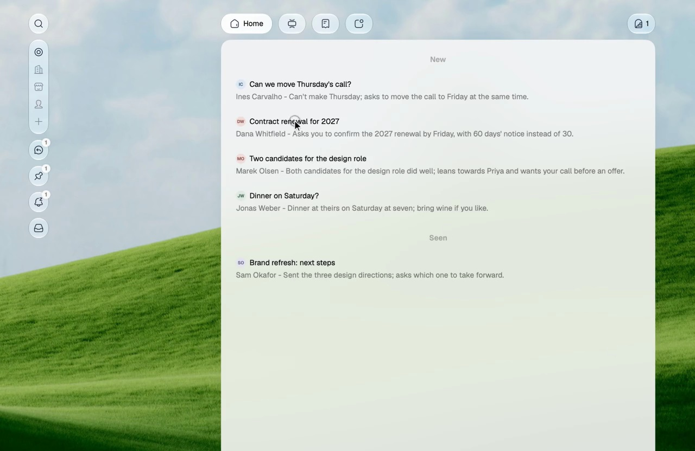

# Usual Mail

One app for your inboxes, sorted on a server you run yourself. Usual Mail brings the conversations that need you
to Home, and gives the rest of your mail a place of its own.



## Mail, with less to sort through

- **Your inboxes together.** Connect your existing Gmail or IMAP mailboxes, switch between them or see them all at
  once. Your mail stays in your mailbox; your server keeps a synced copy.
- **The important things in view.** Home holds your conversations. Newsletters go to Feed, receipts and invoices
  have their own list, and notifications are grouped by when they happen.
- **Know what a message is about.** Your server uses your AI key to sort mail and write short summaries, so you can
  see what needs your attention at a glance. One-time codes are never summarized.
- **Choose who gets through.** First mail from new senders waits in Screening for you to let them in or block them.
  Important mail such as sign-in codes and certain verified service messages can still reach you.
- **Make room for later.** Pin a conversation, set it aside for a reply, or snooze it until you need it. Search your
  synced mail and, when you choose, find older mail in Gmail too.
- **Keep control.** You host the server and bring your own AI key. Your mailbox stays the main copy, and your own
  agent can connect to the server too. Once you add an AI key, the server processes mail from every inbox with it.

**Usual Mail is early.** Much of it has not been tried outside the project's own tests.

## Deploy your own

Usual Mail is self-hosted. **Start with Docker Compose** on your computer. From a new folder, run:

```sh
curl -fsSLO https://raw.githubusercontent.com/usual-labs/usual-mail/main/compose.yaml
docker compose up -d --no-build --wait
```

Open [the local dashboard](http://127.0.0.1:8484) and set your password. For your own domain or reverse proxy,
follow the [deployment guide](docs/deploy.md).

For a public server, [reserve access for yourself](docs/deploy.md#claiming-your-server). Cloudflare requires Workers
Paid and supports Gmail only. Render and Azure use paid resources.

[](https://deploy.workers.cloudflare.com/?url=https://github.com/usual-labs/usual-mail)
[](https://render.com/deploy?repo=https://github.com/usual-labs/usual-mail)
[](https://portal.azure.com/#create/Microsoft.Template/uri/https%3A%2F%2Fraw.githubusercontent.com%2Fusual-labs%2Fusual-mail%2Fmain%2Fdeploy%2Fazure%2Fmain.json)

[Import on Railway](docs/deploy.md#railway) · [Set up on Coolify](docs/deploy.md#coolify) · [Launch a stack on AWS](docs/deploy-cloud-vms.md#aws)

## Contributing and licence

Usual Mail is free software under the [GNU AGPL-3.0](LICENSE). See [Contributing](CONTRIBUTING.md), the draft
[contributor agreement](CLA.md), and [third-party notices](THIRD_PARTY_NOTICES.md).
